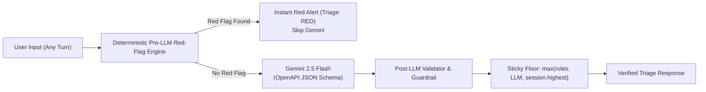

# Personal Health Assistant: System Architecture Specification (v2.0)

## 1. Architectural Overview & Design Principles

The Personal Health Assistant is an **ephemeral, privacy-first, zero-retention health triage platform**. Designed for home and remote users experiencing symptoms, it delivers immediate clinical stratification, conversational follow-up intake, direct in-context document grounding, and asynchronous emergency facility routing using **100% free and open external providers**.

### Core Architectural Principles
1. **Deterministic-First Safety**: A deterministic red-flag rule engine executes on *every user turn* before any LLM call. The emergency path never depends on LLM availability, latency, rate limits, or provider-side safety filters.
2. **Sticky Escalation Ceiling**: Once an emergency red flag or high-urgency level is established, the session preserves `highest_triage_level`. A subsequent *"it feels better now"* or LLM green output can never downgrade the patient's triage severity. The final level is always `max(rules, LLM, session.highest_triage_level)`.
3. **Session-Independent Emergency Fallback**: Emergency numbers and emergency facility lookups (`POST /api/v1/emergency/facilities`) work **without an active session** so a user experiencing an emergency or hitting a `503 CAPACITY_EXCEEDED` limit is never locked out of emergency guidance.
4. **In-Memory & Direct Context (Zero Heavy RAG)**: PDFs are processed in-memory via streamed byte chunks (zero `/tmp` disk writes) and injected directly into Gemini 2.5 Flash's 1M context window. This preserves complete lab tables and reference ranges intact, avoids third-party embedding API calls, and eliminates vector database complexity.
5. **Zero-Retention & Zero-PHI Observability**: No database, no local disk storage. Session IDs are cryptographically random and held exclusively in `HttpOnly; SameSite=Strict; Secure` cookies that refresh their rolling 30-minute TTL on each request. Server logs and error handlers sanitize payloads to ensure zero PHI leakage.
6. **Non-Streaming v1 Contract**: For robust JSON schema validation, post-LLM escalation floor enforcement, and server-side citation verification, v1 uses atomic JSON request/response cycles.

---

## 2. High-Level System Architecture

```mermaid
flowchart TD
    subgraph Client["Client Tier (React / Vite + Tailwind CSS)"]
        EmergencyStatic["Built-in Emergency Numbers & 911 Dial\n(Works offline / without session)"]
        OnboardForm["Lean Onboarding (Age, Sex, Country)"]
        ChatUI["Interactive Chat & Triage UI"]
        PDFDrop["Streaming PDF Dropzone (Max 10MB, 10 pgs)"]
        WipeButton["'End Session & Wipe' Action"]
        AlertBanner["Instant Red Alert Banner"]
        FacilityCards["Async Nearby 24/7 Facilities"]
    end

    subgraph Backend["Backend Tier (FastAPI - Single Worker / Reverse Proxy)"]
        Router["API Gateway / Sanitized Error Handler"]
        RateLimiter["IP & Session Rate Limiters"]
        SessionMgr["Ephemeral Session Manager (Pydantic + In-Flight Cancellation)"]
        
        subgraph SafetyPipeline["Two-Tier Safety Pipeline"]
            PreRules["Deterministic Pre-LLM Red-Flag Engine (Every Turn)"]
            PostValidator["Post-LLM Validator & Sticky Escalation Floor"]
        end

        TriageEngine["Symptom Triage Engine"]
        DocIngest["Streaming Threadpool PDF Ingestion (PyMuPDF)"]
        EmergencyService["Emergency Service (Coarse Grid Cache + OSM Overpass)"]
    end

    subgraph EphemeralStorage["Ephemeral Storage Tier (Zero Long-Term Retention)"]
        SessionStore["In-Memory Bounded Sessions (Max 100, 30m Rolling TTL)"]
        OverpassCache["In-Memory Spatial Grid Cache (0.05° ~ 5.5km)"]
    end

    subgraph External["Free External Providers (Demo Mode)"]
        GeminiFlash["Google Gemini 2.5 Flash\n(OpenAPI Structured JSON Output)"]
        OSMOverpass["OpenStreetMap Overpass API\n(Free 24/7 ER & Hospital Locator)"]
    end

    EmergencyStatic -.->|No session required| Client
    OnboardForm -->|POST /session/start| Router
    ChatUI -->|POST /chat| Router
    PDFDrop -->|POST /documents/upload| Router
    Client -->|POST /emergency/facilities| Router
    WipeButton -->|POST /session/end| Router

    Router --> RateLimiter --> SessionMgr
    SessionMgr <--> SessionStore

    Router --> PreRules
    PreRules -->|Red Flag Detected| AlertBanner
    PreRules -->|Safe| TriageEngine

    DocIngest -->|In-Memory Text with [Page X]| TriageEngine
    TriageEngine --> GeminiFlash
    GeminiFlash --> PostValidator
    PostValidator --> Router

    Router --> EmergencyService
    EmergencyService <--> OverpassCache
    EmergencyService --> OSMOverpass
    OSMOverpass --> FacilityCards
```

---

## 3. Subsystem Architecture

### 3.1. Safety Layer & Multi-Stage Triage Engine



#### 1. Deterministic Pre-LLM Red-Flag Engine
* **Execution**: Runs on **every user message** before calling Gemini.
* **Coverage**: Acute coronary symptoms, stroke indicators (FAST), severe respiratory distress, acute anaphylaxis, and life-threatening hemorrhage/trauma.
* **Bypass Guarantee**: Instantly returns a `RED` response without waiting for Gemini, immunizing critical patients from LLM latency, token rate limits (`429`), or upstream safety filter rejections.

#### 2. Sticky Escalation Floor & Post-LLM Validator
* **Sticky Triage Floor**: The session maintains `highest_triage_level`. Even if a patient later reports *"my chest pain stopped"*, the final triage level remains `max(rules, LLM, session.highest_triage_level)` to ensure underlying life-threatening conditions (e.g. transient ischemic attacks or intermittent cardiac ischemia) are not dismissed.
* **Medication Directive Redaction**: Regex rules detect and redact directives telling patients to *"stop taking"* prescribed medications or offering specific pharmaceutical dosing adjustments.
* **Citation Verification**: The validator checks that `citation.snippet` is a verifiable substring of the cited page in `citation.filename`. Citations failing this check are discarded.

#### 3. Upstream Failure Fallback
If Gemini returns a `429`, times out (504), or triggers a `FinishReason.SAFETY` block, the system does not fail ungracefully. It returns a safe, pre-configured fallback payload:
```json
{
  "triage_level": "YELLOW",
  "disposition": "PRIMARY_CARE_48H",
  "assessment_status": "NEEDS_MORE_INFO",
  "is_emergency": false,
  "reasoning_summary": "We were unable to complete an automated evaluation of your symptoms at this time. If you are in severe pain or concerned about your condition, please contact local emergency services or seek in-person medical care immediately.",
  "possible_causes": [],
  "warning_signs": ["Sudden severe pain", "Difficulty breathing", "Dizziness or fainting"],
  "follow_up_questions": [],
  "citations": [],
  "uncertainty_note": "Automated evaluation could not be completed safely by upstream services."
}
```

---

### 3.2. Ephemeral Session & Memory Architecture

#### 1. In-Flight Cancellation & Idempotent Purge
* Each session maintains a `terminated: bool` flag.
* When `POST /session/end` is invoked, `terminated` is set to `True` immediately, in-flight asyncio tasks for that session are cancelled, and RAM is purged without waiting for slow background LLM calls to complete.
* Late LLM responses checking `if session.terminated: return` discard their output.
* `/session/end` is idempotent: calling it on an already-expired or terminated session returns `200 OK`.

#### 2. Rolling Cookie Refresh
* The session cookie `session_token` is set with `HttpOnly`, `SameSite=Strict`, and `Secure`.
* To support the 30-minute rolling TTL, every authenticated request re-issues the `Set-Cookie` header with a fresh `Max-Age=1800` matching `expires_at`.
* `GET /session/status` allows the client to inspect remaining seconds **without refreshing the TTL**, enabling an in-app "Session expiring in 5 minutes" modal.

#### 3. Sanitized Error Handling (Zero Input Leaks)
* Default FastAPI 422 handlers echo the raw invalid payload, which could leak patient symptom disclosures into logs.
* A custom exception handler for `RequestValidationError` extracts only the offending field name and validation code (e.g. `{"code": "VALIDATION_ERROR", "detail": "Invalid age: must be between 0 and 125"}`), completely stripping the input value.

---

### 3.3. Hardened In-Memory Document Ingestion


1. **Streaming Size Enforcement**: Bytes are read in 64KB chunks; if cumulative bytes exceed 10MB, the stream terminates immediately with `413 FILE_TOO_LARGE`.
2. **Pre-Extraction Page Check**: PyMuPDF inspects `len(doc)` before iterating through text. If $> 10$ pages, it immediately returns `400 PAGE_LIMIT_EXCEEDED`.
3. **Threadpool Execution & Concurrency Cap**: PyMuPDF extraction runs in `asyncio.to_thread` protected by an `asyncio.Semaphore(3)` to prevent CPU exhaustion on the event loop.
4. **Document Deletion**: Users can remove an attached document via `DELETE /api/v1/documents/{document_id}` without ending the entire session.

---

### 3.4. Session-Independent Emergency Locator & Spatial Cache

* **Public & Decoupled**: `POST /api/v1/emergency/facilities` does not require a session.
* **Payload Coordinates**: Sent via POST body, preventing GPS coordinates or postal codes from entering access logs or browser history.
* **Coordinate Truncation**: Coordinates are rounded server-side to 2 decimal places ($\approx 1.1\text{km}$) before querying.
* **In-Memory Coarse-Grid Cache**: Query results are cached for 1 hour keyed by `(round(lat / 0.05) * 0.05, round(lon / 0.05) * 0.05)`. This protects the public Overpass servers from query bursts and holds no health data.
* **Country-Specific Dispatch Table**: Server resolves emergency numbers dynamically (`"US"` $\rightarrow$ `["911"]`, `"GB"` $\rightarrow$ `["999", "112"]`, `"ZA"` $\rightarrow$ `["10177", "112"]`, `"AU"` $\rightarrow$ `["000"]`).
