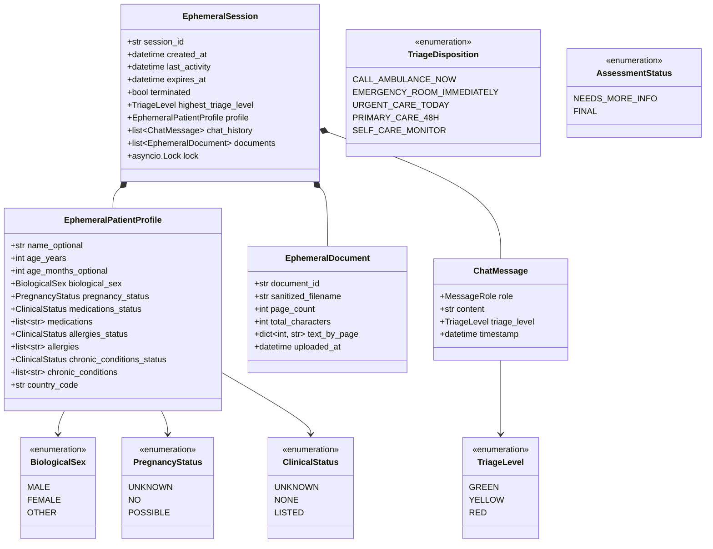

# Personal Health Assistant: Data & API Schema Specification (v2.0)

This document provides the hardened, production-grade schema design for the Personal Health Assistant. It governs:
1. **In-Memory Domain Schema**: Volatile, session-scoped Pydantic models with explicit state tracking, resource bounds, and zero persistence.
2. **REST API Contract Schemas**: Strict request/response definitions, sanitized error shapes, cookie semantics, and decoupled emergency routing.
3. **LLM Structured Output JSON Schema**: OpenAPI-compliant Gemini 2.5 Flash response schema enforcing triage disposition, separate possible causes, warning signs, and provisional status.
4. **Emergency Numbers & Facility Caching Specification**: Multi-country dispatch table and coarse-grid spatial cache.

---

## 1. Ephemeral In-Memory Domain Schema

All patient state is stored strictly in volatile server RAM with a rolling 30-minute Time-To-Live (TTL). No patient data is written to disk or database.



### 1.1 Domain Field Specifications

#### `EphemeralPatientProfile`
| Field | Type | Required | Constraints | Description |
|---|---|---|---|---|
| `name` | `str \| None` | No | Max 50 chars, trimmed | Patient preferred name/alias. Never forwarded to LLM. |
| `age_years` | `int` | Yes | $0 \le \text{age} \le 125$ | Patient age in years. $0$ indicates an infant under 1 year. |
| `age_months` | `int \| None` | No | $0 \le \text{months} \le 23$ | Captured for infants and toddlers under 2 years. |
| `biological_sex` | `BiologicalSex` | Yes | `male`, `female`, `other` | Clinical sex for demographic risk stratification. |
| `pregnancy_status` | `PregnancyStatus` | Yes | `unknown`, `no`, `possible` | If female/other aged 12–55, prompted in follow-up. `unsure` maps to `possible`. |
| `medications_status` | `ClinicalStatus` | Yes | `unknown`, `none`, `listed` | Disambiguates "not asked yet" vs "takes no meds" vs "active list". |
| `medications` | `list[str]` | Yes | Max 10 items, max 50 chars each | Current regular prescriptions, OTC drugs, or supplements. |
| `allergies_status` | `ClinicalStatus` | Yes | `unknown`, `none`, `listed` | Disambiguates "unknown" vs "no allergies" vs "allergies present". |
| `allergies` | `list[str]` | Yes | Max 10 items, max 50 chars each | Known drug or severe environmental/food allergies. |
| `chronic_conditions_status` | `ClinicalStatus` | Yes | `unknown`, `none`, `listed` | Disambiguates background comorbidities. |
| `chronic_conditions` | `list[str]` | Yes | Max 10 items, max 50 chars each | E.g. diabetes, asthma, hypertension, immunosuppression. |
| `country_code` | `str` | Yes | 2-letter ISO 3166-1 alpha-2 (default: `"US"`) | Used to resolve emergency phone numbers server-side. |

#### `EphemeralDocument`
| Field | Type | Required | Constraints | Description |
|---|---|---|---|---|
| `document_id` | `str` | Yes | 16-character secure token | Unique document identifier within session. |
| `sanitized_filename` | `str` | Yes | Max 100 chars, alphanumeric + `._-` | Safe filename stripped of path separators and HTML/XML. |
| `page_count` | `int` | Yes | $1 \le \text{pages} \le 10$ | Verified before text extraction starts. |
| `total_characters` | `int` | Yes | Minimum 50 chars/page average | Verified to prevent scanned PDFs without selectable text. |
| `text_by_page` | `dict[int, str]` | Yes | Key: 1-indexed page | Text content per page, capped at 15,000 total tokens per file. |
| `uploaded_at` | `datetime` | Yes | UTC timestamp | Ingestion timestamp. |

#### `ChatMessage`
| Field | Type | Required | Constraints | Description |
|---|---|---|---|---|
| `role` | `MessageRole` | Yes | `user` or `assistant` | Turn speaker. |
| `content` | `str` | Yes | User max 2000 chars; Assistant max 4000 chars | Conversational message content. |
| `triage_level` | `TriageLevel \| None` | No | `GREEN`, `YELLOW`, `RED`, `null` | Assigned triage level if assistant turn. |
| `timestamp` | `datetime` | Yes | UTC timestamp | Turn timestamp. |

#### `EphemeralSession`
| Field | Type | Required | Constraints | Description |
|---|---|---|---|---|
| `session_id` | `str` | Yes | 32-byte URL-safe base64 string | Never returned in JSON bodies; held in cookie only. |
| `created_at` | `datetime` | Yes | UTC timestamp | Session creation time. |
| `last_activity` | `datetime` | Yes | UTC timestamp | Updated on every authenticated request. |
| `expires_at` | `datetime` | Yes | UTC timestamp | Calculated as `last_activity + 30 minutes`. |
| `terminated` | `bool` | Yes | Default: `False` | Set immediately on `POST /session/end` to abort in-flight work. |
| `highest_triage_level` | `TriageLevel` | Yes | Default: `GREEN` | Sticky escalation ceiling: `max(rules, LLM, current)`. Never downgraded. |
| `profile` | `EphemeralPatientProfile` | Yes | Valid profile | Demographic and health baseline context. |
| `chat_history` | `list[ChatMessage]` | Yes | Max 50 turns retained in RAM | Sliding window of recent 6 turns passed to LLM. |
| `documents` | `list[EphemeralDocument]` | Yes | Max 3 documents | Total token budget capped at 45,000 tokens. |
| `lock` | `asyncio.Lock` | Yes | Excluded from serialization | Per-session concurrency lock. |

---

## 2. REST API Contract Schemas

### 2.1 Session Lifecycle (`/api/v1/session`)

#### `POST /api/v1/session/start`
Starts a guest session and issues an `HttpOnly`, `SameSite=Strict` cookie.
* **Rate Limit**: 5 requests/minute per client IP.
* **Global Capacity**: Max 100 concurrent active sessions (returns `503 CAPACITY_EXCEEDED` if full).

* **Request (`StartSessionRequest`)**:
```json
{
  "name": "Sarah",
  "age_years": 29,
  "age_months": null,
  "biological_sex": "female",
  "country_code": "US"
}
```

* **Response (`SessionResponse`)** — `201 Created`:
```json
{
  "age_years": 29,
  "biological_sex": "female",
  "country_code": "US",
  "emergency_numbers": ["911"],
  "expires_at": "2026-11-09T08:59:37Z",
  "disclaimer_version": "v1.0"
}
```
*(Notice: `session_id` is intentionally omitted from the JSON body to defeat XSS leakage. It exists solely in the `HttpOnly` cookie).*

* **Cookie Header**:
```http
Set-Cookie: session_token=rX8...; Path=/; HttpOnly; SameSite=Strict; Secure; Max-Age=1800
```

---

#### `GET /api/v1/session/status`
Checks remaining session time and highest triage level **without refreshing the 30-minute rolling TTL**.

* **Response (`SessionStatusResponse`)** — `200 OK`:
```json
{
  "active": true,
  "expires_at": "2026-11-09T08:59:37Z",
  "seconds_remaining": 1420,
  "highest_triage_level": "YELLOW",
  "documents_count": 1
}
```

---

#### `POST /api/v1/session/keep-alive`
Explicitly refreshes the session's rolling TTL by another 30 minutes and re-issues the cookie with a fresh `Max-Age`.

* **Response (`KeepAliveResponse`)** — `200 OK`:
```json
{
  "refreshed": true,
  "expires_at": "2026-11-09T09:29:37Z"
}
```

---

#### `POST /api/v1/session/end`
Idempotent endpoint. Sets `session.terminated = True`, purges RAM, and clears cookie.

* **Response (`EndSessionResponse`)** — `200 OK`:
```json
{
  "message": "Session terminated and all memory wiped.",
  "purged": true
}
```

---

### 2.2 Chat & Symptom Triage (`/api/v1/chat`)

#### `POST /api/v1/chat`
Submits user symptoms.
* Evaluates deterministic rules first on every turn.
* If safe, calls Gemini 2.5 Flash for structured evaluation.
* Enforces sticky escalation floor: `max(rules, llm, session.highest_triage_level)`.
* Re-issues refreshed `session_token` cookie.

* **Request (`ChatRequest`)**:
```json
{
  "message": "Severe lower abdominal pain since this morning, pain is 7/10 and getting worse."
}
```
*(Note: Coordinates are not sent in chat requests to avoid leaking high-precision location into conversational logs).*

* **Response (`TriageResponse`)** — `200 OK`:
```json
{
  "triage_level": "RED",
  "disposition": "EMERGENCY_ROOM_IMMEDIATELY",
  "assessment_status": "FINAL",
  "is_emergency": true,
  "reasoning_summary": "Severe acute lower abdominal pain rated 7/10 in a reproductive-aged female requires immediate emergency medical evaluation to rule out acute appendicitis, ovarian torsion, or ectopic pregnancy.",
  "possible_causes": [
    {
      "name": "Acute Appendicitis",
      "explanation": "Sudden onset of severe lower abdominal pain that intensifies quickly."
    },
    {
      "name": "Ovarian Torsion or Ruptured Cyst",
      "explanation": "Severe lower quadrant pelvic or abdominal pain requiring acute imaging."
    },
    {
      "name": "Ectopic Pregnancy",
      "explanation": "Severe lower abdominal pain in females of childbearing potential, which is a surgical emergency."
    }
  ],
  "warning_signs": [
    "Sudden dizziness, fainting, or feeling lightheaded",
    "Fever, chills, or persistent vomiting",
    "Inability to stand upright or walk due to pain"
  ],
  "follow_up_questions": [],
  "citations": [],
  "uncertainty_note": null,
  "emergency_numbers": ["911"],
  "expires_at": "2026-11-09T09:29:37Z"
}
```

---

### 2.3 Document Ingestion & Deletion (`/api/v1/documents`)

#### `POST /api/v1/documents/upload`
Uploads an optional PDF.
* Enforces 10MB limit **while streaming chunks**, terminating early if size exceeded.
* Checks page count ($\le 10$) from trailer before text extraction.
* Runs PyMuPDF in `asyncio.to_thread` with an extraction timeout (5s) and `asyncio.Semaphore(3)`.
* Verifies $\ge 50$ chars/page average to reject scanned PDFs.

* **Response (`DocumentUploadResponse`)** — `200 OK`:
```json
{
  "document_id": "doc_9f8a7b6c5d4e",
  "filename": "blood_panel_nov2026.pdf",
  "page_count": 3,
  "total_characters": 3410,
  "message": "Document uploaded and indexed in memory for this session."
}
```

#### `DELETE /api/v1/documents/{document_id}`
Allows users to drop a single document without ending the session.

* **Response (`DocumentDeleteResponse`)** — `200 OK`:
```json
{
  "document_id": "doc_9f8a7b6c5d4e",
  "deleted": true
}
```

---

### 2.4 Emergency Facility Locator (`/api/v1/emergency/facilities`)

#### `POST /api/v1/emergency/facilities`
Public, rate-limited endpoint (20 requests/minute). **Does not require a session**, allowing lock-out prevention.
* Uses POST so coordinates and postal codes are not logged in access logs or browser history.
* Coordinates are rounded server-side to 2 decimal places ($\approx 1.1\text{km}$) before querying.
* Results are cached per $0.05^\circ \times 0.05^\circ$ spatial grid ($\approx 5.5\text{km}$) in memory.

* **Request (`EmergencyFacilityQuery`)**:
```json
{
  "latitude": 37.77,
  "longitude": -122.42,
  "city": null,
  "postal_code": null,
  "country_code": "US"
}
```

* **Response (`EmergencyFacilitiesResponse`)** — `200 OK`:
```json
{
  "emergency_numbers": ["911"],
  "facilities": [
    {
      "name": "Zuckerberg San Francisco General Hospital",
      "straight_line_distance_km": 2.1,
      "facility_type": "hospital",
      "has_emergency_department": true,
      "phone": "+1-415-206-8000",
      "address": "1001 Potrero Avenue, San Francisco, CA",
      "hours": "24/7",
      "hours_verified": false,
      "maps_url": "https://www.google.com/maps/search/?api=1&query=37.75,-122.40"
    }
  ],
  "caveat": "Always call ahead or call emergency services directly if experiencing life-threatening symptoms.",
  "cached": true
}
```

---

## 3. LLM Structured Output JSON Schema (OpenAPI-Compliant)

Configured via `gemini-2.5-flash` using strict OpenAPI 3.0 types (compatible with Gemini `response_schema`):

```json
{
  "type": "object",
  "properties": {
    "triage_level": {
      "type": "string",
      "enum": ["GREEN", "YELLOW", "RED"]
    },
    "disposition": {
      "type": "string",
      "enum": [
        "CALL_AMBULANCE_NOW",
        "EMERGENCY_ROOM_IMMEDIATELY",
        "URGENT_CARE_TODAY",
        "PRIMARY_CARE_48H",
        "SELF_CARE_MONITOR"
      ]
    },
    "assessment_status": {
      "type": "string",
      "enum": ["NEEDS_MORE_INFO", "FINAL"]
    },
    "reasoning_summary": {
      "type": "string",
      "description": "Clinical explanation framing findings for discussion with a doctor. Never prescribe or advise stopping medications."
    },
    "possible_causes": {
      "type": "array",
      "items": {
        "type": "object",
        "properties": {
          "name": { "type": "string" },
          "explanation": { "type": "string" }
        },
        "required": ["name", "explanation"]
      }
    },
    "warning_signs": {
      "type": "array",
      "items": { "type": "string" },
      "description": "Specific red flags that mandate immediate emergency evaluation if they develop."
    },
    "follow_up_questions": {
      "type": "array",
      "maxItems": 3,
      "items": { "type": "string" },
      "description": "Up to 3 targeted follow-up questions inquiring about pregnancy, medications, allergies, or onset/severity."
    },
    "extracted_profile_updates": {
      "type": "object",
      "properties": {
        "pregnancy_status": {
          "type": "string",
          "enum": ["unknown", "no", "possible"],
          "nullable": true
        },
        "medications_status": {
          "type": "string",
          "enum": ["unknown", "none", "listed"],
          "nullable": true
        },
        "medications_mentioned": {
          "type": "array",
          "items": { "type": "string" }
        },
        "allergies_status": {
          "type": "string",
          "enum": ["unknown", "none", "listed"],
          "nullable": true
        },
        "allergies_mentioned": {
          "type": "array",
          "items": { "type": "string" }
        },
        "chronic_conditions_mentioned": {
          "type": "array",
          "items": { "type": "string" }
        }
      },
      "required": ["medications_mentioned", "allergies_mentioned", "chronic_conditions_mentioned"]
    },
    "citations": {
      "type": "array",
      "items": {
        "type": "object",
        "properties": {
          "filename": { "type": "string" },
          "page_number": { "type": "integer" },
          "snippet": { "type": "string" },
          "relevance": { "type": "string" }
        },
        "required": ["filename", "page_number", "snippet", "relevance"]
      }
    },
    "uncertainty_note": {
      "type": "string",
      "nullable": true
    }
  },
  "required": [
    "triage_level",
    "disposition",
    "assessment_status",
    "reasoning_summary",
    "possible_causes",
    "warning_signs",
    "follow_up_questions",
    "extracted_profile_updates",
    "citations"
  ]
}
```

---

## 4. International Emergency Dispatch Table

The server resolves emergency dispatch numbers dynamically using `country_code`:

| Country Code | Country Name | Primary Emergency Number(s) |
|---|---|---|
| `US` | United States | `["911"]` |
| `CA` | Canada | `["911"]` |
| `GB` | United Kingdom | `["999", "112"]` |
| `ZA` | South Africa | `["10177", "112"]` |
| `AU` | Australia | `["000"]` |
| `NZ` | New Zealand | `["111"]` |
| `EU` / *Default* | European Union / Global Standard | `["112"]` |

---

## 5. Standardized Machine-Readable Error Responses

All error payloads strictly follow:
```json
{
  "code": "MACHINE_READABLE_CODE",
  "detail": "Human-readable sanitized message (never echoing raw user symptoms or input)."
}
```

| HTTP Status | Error Code | Description |
|---|---|---|
| `400 Bad Request` | `INVALID_DOCUMENT_FORMAT` | File is not a valid `%PDF-` document, is corrupt, or encrypted. |
| `400 Bad Request` | `PAGE_LIMIT_EXCEEDED` | PDF exceeds the 10-page limit. |
| `400 Bad Request` | `MAX_DOCUMENTS_REACHED` | Session already contains 3 uploaded documents. |
| `401 Unauthorized` | `SESSION_EXPIRED` | Session expired due to 30-minute inactivity or invalid token. |
| `409 Conflict` | `REQUEST_ALREADY_IN_FLIGHT`| Another request is already processing on this session lock. |
| `413 Payload Too Large` | `FILE_TOO_LARGE` | PDF stream exceeded 10MB during streaming. |
| `422 Unprocessable Entity`| `SCANNED_DOCUMENT` | Document has $< 50$ chars/page average (image scan). |
| `422 Unprocessable Entity`| `VALIDATION_ERROR` | Schema validation error (field names and error codes only; input stripped). |
| `429 Too Many Requests`| `RATE_LIMIT_EXCEEDED` | Client IP or session exceeded request rate. |
| `502 Bad Gateway` | `UPSTREAM_LLM_FAILURE` | Gemini API returned a 5xx or unrecoverable response. |
| `503 Service Unavailable`| `CAPACITY_EXCEEDED` | Server reached 100 concurrent active guest sessions. |
| `504 Gateway Timeout` | `UPSTREAM_TIMEOUT` | Gemini API or OpenStreetMap query timed out. |
